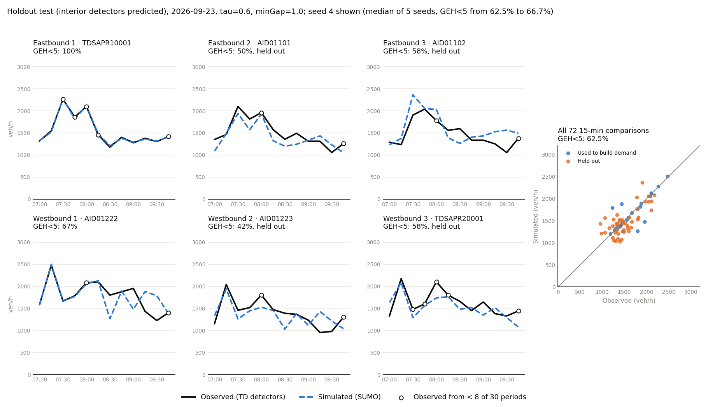

# SUMO model of a Hong Kong corridor, calibrated to detector data

[](https://github.com/luluwei-Amelia/sumo-signal-demo/actions/workflows/tests.yml)

A SUMO model of Aberdeen Praya Road (1.6 km, 4 signalised junctions, 5 pedestrian crossings,
left-hand traffic), with demand built from Transport Department detector counts on two weekday
mornings in September 2026. The work covers network import, detector matching, a SQLite data
store, demand estimation, multi-seed calibration, a holdout test against a naive benchmark and a
signal-plan comparison under a validity rule.

Results page: https://luluwei-amelia.github.io/sumo-signal-demo/



## Main results

| Question | Result |
|---|---|
| Does the model match the counts it was fitted to? | Yes: GEH < 5 for 94.1% of 15-min comparisons on 22 Sep (5 seeds, 87.5-97.2%) |
| Are the fitted parameters realistic? | Doubtful: queue discharge of about 2,250 veh/h/lane against a UK benchmark of about 2,080 pcu/h, and the mid-block detectors see moving traffic, so the counts hardly constrain capacity |
| Does it predict detectors it never saw? | No better than scaling the previous day: 53.3% against 58.3% at 15 min, 91.7% against 75.0% hourly (12 comparisons), sign test p = 0.31 |
| Can it rank signal plans? | Not yet. Only fixed-time and actuated control produce valid runs, and their order reversed between two network versions |

Details, figures and limitations: [hk_corridor/README.md](hk_corridor/README.md).

## Repository

| Folder | Content |
|---|---|
| [hk_corridor/](hk_corridor/) | The corridor model: scripts, network, detector data, results |
| [docs/](docs/) | The static results page (Leaflet map, Plotly charts), built from `hk_corridor/export_dashboard.py` |
| [examples/single_intersection/](examples/single_intersection/) | An earlier single-intersection study: fixed-time, Webster and actuated control over 90 runs |
| [tests/](tests/) | pytest tests for the scoring, validity rule, signal-plan editing and Webster timing |

Every run is checked against one rule: at most 50 teleports and no vehicles left outside or inside
the network at the end. Results that fail it are reported but not compared.

## Running it

Tested with SUMO 1.18.0 and Python 3.11 on Windows; versions in `requirements.txt`.

```bash
pip install -r requirements.txt
cd hk_corridor
QUICK=1 python calibrate.py     # one seed, 4 parameter sets, about 6 min on 4 cores
```

The full sequence and run times are in [hk_corridor/README.md](hk_corridor/README.md#how-to-run).
Tests run per folder, since both parts have a `saturation` module:

```bash
python -m pytest tests/hk_corridor
python -m pytest tests/single_intersection
```

## Data

Road network (c) OpenStreetMap contributors, ODbL. Detector counts, speeds and locations from the
Transport Department, HKSAR Government, via DATA.GOV.HK. Vehicle mix from the TD Annual Traffic
Census 2024. Full attribution in [hk_corridor/README.md](hk_corridor/README.md#data).

## License

MIT for the code. The data keep their own licences.
