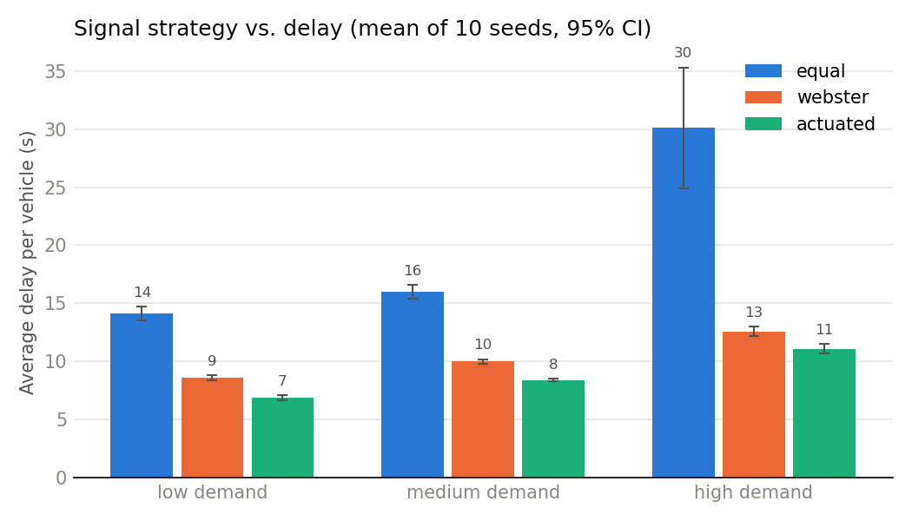

# Single intersection: fixed-time, Webster and actuated control

The first part of this repository, done before the corridor model. One made-up 4-arm intersection
with left-hand traffic, 3 demand levels and 3 signal strategies, run through TraCI.



## Setup

| | |
|---|---|
| Network | 4-arm signalised intersection, 200 m approaches, 2 lanes each way, 50 km/h |
| Demand | Random arrivals. Medium level: 500 veh/h per north-south approach, 250 veh/h per east-west approach. 70% through, 15% left, 15% right |
| Demand levels | low x0.6, medium x1.0, high x1.4 |
| Strategies | equal: fixed-time, 30 s green each way (66 s cycle). webster: fixed-time, cycle and splits from Webster's formula. actuated: SUMO gap-based actuation, green 5-50 s |
| Runs | 10 seeds per scenario, 90 runs in total, 95% confidence intervals |
| Warm-up | first 600 s dropped |
| Metrics | delay = time lost while driving (SUMO timeLoss) + time spent waiting to enter the network; mean travel time; peak number of halting vehicles |
| Validity | runs with any teleport would be flagged; none of the 90 runs had one |

## Saturation flow for Webster

Instead of assuming 1,800 veh/h/lane, `saturation.py` measures it in the model: permanent green for
north-south, the north approach overloaded, the opposite approach at normal demand. The result is
1,352 veh/h/lane. Right-turners waiting for gaps in the opposing flow probably pull it down; I did not
run a test without opposing traffic to confirm this. The same value is used for every demand level
and for east-west, although the opposing flows differ.

| Demand | N-S green (s) | E-W green (s) | Cycle (s) |
|---|---:|---:|---:|
| low | 10 | 10 | 26 |
| medium | 11 | 10 | 27 |
| high | 14 | 10 | 30 |

E-W green sits at the 10 s minimum at all three levels.

## Results (mean of 10 seeds)

| Demand | Strategy | Mean delay (s) | 95% CI (+/- s) | Mean travel time (s) | Peak halting vehicles |
|---|---|---:|---:|---:|---:|
| low | equal | 14.1 | 0.6 | 44.3 | 11.2 |
| low | webster | 8.6 | 0.2 | 38.8 | 7.0 |
| low | actuated | 6.9 | 0.2 | 37.1 | 5.0 |
| medium | equal | 16.0 | 0.6 | 46.2 | 17.1 |
| medium | webster | 10.0 | 0.2 | 40.2 | 10.7 |
| medium | actuated | 8.4 | 0.1 | 38.6 | 9.1 |
| high | equal | 30.1 | 5.2 | 60.3 | 33.5 |
| high | webster | 12.6 | 0.4 | 42.8 | 15.4 |
| high | actuated | 11.1 | 0.4 | 41.3 | 15.3 |

Webster has 39-58% less delay than the equal plan. Its splits are nearly equal anyway, so most of
the gain is probably the shorter cycle (26-30 s against 66 s). A real junction could not run cycles
that short once pedestrian phases are included.

With the equal plan, delay rises from 16.0 to 30.1 s between medium and high demand and the spread
between seeds grows (+/- 5.2 s). This is not a capacity limit: with the measured saturation flow
the N-S degree of saturation at high demand is about 0.6. Right-turners blocking the offside lane
are one possible cause; I have not checked it.

Actuated control is 1.4-1.7 s better than Webster at all levels. The comparison favours actuation,
because actuated greens can end after 5 s and Webster greens only after 10 s.

## How to run

Needs SUMO with SUMO_HOME set. From this folder:

```bash
python run_experiments.py          # all 90 runs, about 15 min, writes results/
python run_experiments.py --gui    # watch one high-demand run in sumo-gui
```

## Files

| File | |
|---|---|
| `network/*.nod.xml`, `*.edg.xml` | the intersection in plain XML |
| `build_network.py` | builds the network with netconvert (left-hand traffic) |
| `demand.py` | route files for each demand level |
| `saturation.py` | measures saturation flow in the model |
| `signal_plans.py` | writes the equal, Webster and actuated programmes |
| `run_experiments.py` | runs everything through TraCI, drops the warm-up, computes the CIs, writes tables and the chart |

## Limitations

- Demand and turning shares are made up.
- Lost time (4 s per phase) and minimum green (10 s) are assumed. No pedestrian phases, no all-red.
- Right turns are permissive, with no arrow.
- One isolated intersection.
- Default SUMO car-following parameters.
