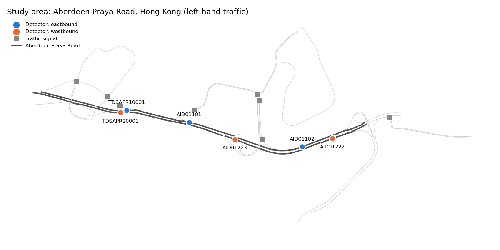
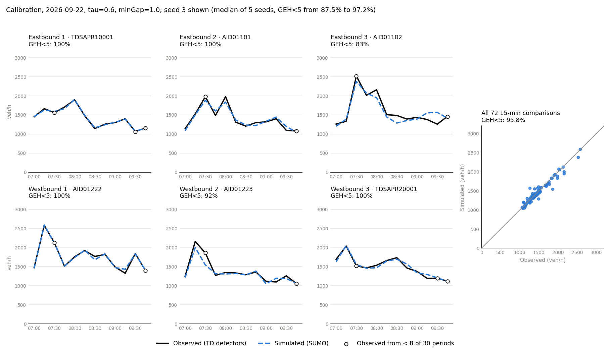
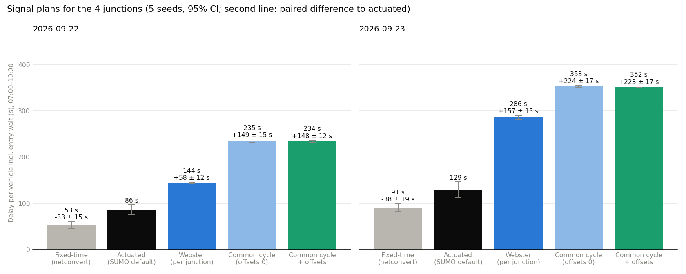

# Aberdeen Praya Road in SUMO

A SUMO model of Aberdeen Praya Road in Aberdeen, Hong Kong: about 1.6 km with 4 signalised
junctions and 5 signalised pedestrian crossings. Demand comes from Transport Department (TD)
detector counts for two weekday mornings, Tue 22 and Wed 23 September 2026.

Results page: https://luluwei-amelia.github.io/sumo-signal-demo/

Summary. On the calibration day the model matches the counts, but only with car-following
parameters at the edge of the grid, and the counts cannot really test those parameters (see
"What the counts can and cannot tell"). On a second day it predicts the interior detectors no
better than scaling the previous day's counts. Of the five signal plans, only fixed-time and
actuated control run cleanly, and their ranking was reversed in the previous network version.
The model is not yet fit for comparing signal plans; the sections below show the evidence and the
data it would need.



| | |
|---|---|
| Network | OpenStreetMap main roads, converted with netconvert (left-hand traffic), one lane count corrected |
| Signals | timings are not published, so netconvert generates them; actuated control during calibration |
| Detectors | 6 TD detectors, 3 eastbound and 3 westbound, 3 lanes each |
| Data | TD 30-second counts, speeds and lane use from the DATA.GOV.HK archive, stored in SQLite (`db.py`) |
| Period | simulated 06:45-10:15, scored 07:00-10:00 in 15-min bins (6 detectors x 12 bins = 72 comparisons) |
| Fit measure | GEH on hourly rates; target GEH < 5 for at least 85% of comparisons (DfT TAG unit M3.1) |
| Vehicles | cars only in the main runs; TD census vehicle mix as a sensitivity run |
| Seeds | 5 per parameter set and per signal plan; a run is valid with at most 50 teleports and no vehicles left outside or inside the network at the end |

## Calibration (22 Sep)

Demand is fitted to the 22 Sep counts with routeSampler, so the counts will match unless the
model builds queues that do not exist on the real road. Three parameters were varied:

- tau: desired minimum time headway in the Krauss model (default 1.0 s)
- minGap: gap to the car in front when stopped (default 2.5 m)
- lcKeepRight: how strongly cars return to the kerbside lane (default 1)

The detectors show a lot of traffic in the offside lane. In a first grid, on the previous network
version, lcKeepRight = 0 gave a lower lane-share error in all 16 (tau, minGap) pairs, so it is
fixed at 0 here.

| tau (s) | minGap (m) | GEH < 5 (mean of 5 seeds) | min-max over seeds | lane-share error (pp) | max teleports | valid |
|---:|---:|---:|---:|---:|---:|---|
| 0.5 | 1.0 | 95.0% | 93.1-95.8% | 19.3 | 19 | yes |
| 0.6 | 1.0 | 94.1% | 87.5-97.2% | 18.7 | 23 | yes, selected |
| 0.8 | 1.0 | 87.8% | 79.2-95.8% | 18.1 | 31 | yes |
| 0.6 | 1.5 | 86.4% | 84.7-88.9% | 18.5 | 36 | yes |
| 0.5 | 1.5 | 85.8% | 77.8-95.8% | 19.1 | 15 | yes |
| 1.0 | 2.5 | 70.3% | 68.1-72.2% | 17.8 | 38 | no (up to 34 vehicles not inserted) |
| SUMO defaults, lcKeepRight 1 | | 70.8% | 66.7-73.6% | 18.9 | 43 | no (up to 58 vehicles not inserted) |

Full table in `results/calibration_grid.csv`. Among the valid sets within 2 points of the best mean
(about one standard error of a 5-seed mean), the one with the lowest lane-share error was chosen.
Lane-share error is the mean absolute difference between simulated and observed lane shares, at
the five detectors where the model has the same number of lanes as the detector.

All runs use a 0.5 s step. An earlier grid with SUMO's default 1 s step reached about 98% for
tau = 0.6-0.8 s, but with 7,000-8,300 teleports: when tau is below the step length the Krauss model
is not collision-free, and teleported cars jump past the bottlenecks. That grid was discarded
(`results/calibration_grid_step1s_invalid.csv`).

The figure shows the median seed of the selected set (seed 3, 95.8%), not the best one.



### What the counts can and cannot tell

All six detectors are mid-block. Five of them see 61-71 km/h on average between 07:00 and 10:00
(volume-weighted, both days), and the sixth, TDSAPR10001, about 47 km/h: they see moving traffic,
not junction queues. Their counts are therefore set by demand, which routeSampler fits directly, and
say little about the junction capacity that tau and minGap control. The grid finds parameters under
which the network does not form queues that would hold back the counts; it does not measure how
Hong Kong drivers follow each other.

The fitted values support this reading:

- minGap 1.0 m is the smallest value tried, and tau cannot go below the 0.5 s step.
- With these values queues discharge at about 2,250 veh/h/lane (`saturation.py`: 1,897 headways on
  6 approach lanes at 3 junctions over 5 seeds; median headway 1.5 s; 2,060-2,334 veh/h/lane
  between seeds). The UK benchmark for a 3.25 m lane is about 2,080 pcu/h, less 140 for the
  nearside lane (Kimber et al., 1986, TRRL RR67). 54% of the headways come from one lane.
- Lane use is still far off. At AID01102 the kerbside lane has 23% of the real traffic and 61% in
  the model; at TDSAPR10001 the offside lane has 39% real and 3% in the model.

The parameters most likely make up for missing capacity in the network or in the generated signal
timings. Calibration was also done under actuated control, so the values are tied to that assumption.

## Census vehicle mix (sensitivity run)

No counting station on Aberdeen Praya Road is classified by vehicle type, so the nearest one that
is was used: TD Annual Traffic Census 2024, core station 1004 (Aberdeen Tunnel). Weekdays
07:00-10:00: cars, taxis and motorcycles 69.3%, light goods vehicles 15.9%, buses 7.8%, light buses
4.1%, medium and heavy goods vehicles 2.9%.

With this mix the best grid point only reaches 75.3% (`results/calibration_grid_census.csv`) and no
parameter set is valid. Westbound traffic queues back from a 4-to-3 lane merge just after AID01222.
In reality the kerbside lane there turns left into a side street, but side streets are not in the
model, so that lane has to merge back. Two fixes were tried, keeping the first section of every
side street and giving turning lanes short exit-only stubs, and both jammed the corridor. The main
runs therefore use cars only, which is unrealistic for a bus route.

## Second day (23 Sep)

Both tests use the parameters from 22 Sep.

- Transfer: demand rebuilt from all six 23 Sep counts. The counts are partly matched by
  construction, so this is a weak test.
- Holdout: demand is the 22 Sep routes, scaled per direction and 15-min bin by the 23 Sep count at
  the first detector in each direction (TDSAPR10001 eastbound, AID01222 westbound). The four
  interior detectors are never used, so the model is predicting them. The benchmark is a naive
  forecast: the 22 Sep interior count times the same ratio.

| Test | Scored on | Model (mean of 5 seeds) | Naive forecast | Valid runs |
|---|---|---:|---:|---:|
| Calibration day | all 6 detectors, 15 min | 94.1% | | 5 of 5 |
| Transfer | all 6 detectors, 15 min | 82.2% | | 0 of 5 |
| Holdout | 4 interior detectors, 15 min | 53.3% | 58.3% | 5 of 5 |
| Holdout | same, bins with at least 8 of 30 periods | 57.3% | 67.6% | |
| Holdout | same, hourly (12 comparisons) | 91.7% | 75.0% | |
| Holdout | mean GEH, 15 min | 4.80 | 5.47 | |


At 15 minutes the model passes fewer comparisons than the naive forecast; hourly it passes more,
but 12 comparisons is too few to separate 11 from 9 passes. Taking each interior bin as one
comparison, the model is closer to the observed count in 20 of 48 bins (sign test p = 0.31).
The model and the naive forecast cannot be told apart on these data.

Part of the 15-min miss is in the data. Only 128 (22 Sep) and 140 (23 Sep) of the 360 thirty-second
periods could be downloaded, so each 15-min count is scaled up from 3-18 periods. Resampling the
available periods (`counts.sampling_noise`) shows that a model reproducing the true counts exactly
would still pass only about 78% of the interior 15-min comparisons.

None of the transfer runs passes the validity rule: they have 38-79 teleports, and 1-39 cars are
still in the network at the end.

Speed error is 5.3-5.6 km/h with the fitted parameters and 6.0-6.1 km/h with the defaults. Most of
it is TDSAPR10001, where the model runs at about 64 km/h against 47 km/h observed.

## Signal plans

The 9 signals are 4 junctions and 5 mid-block pedestrian crossings. There are no pedestrians in the
model, so the crossings keep the same fixed timing in every plan and only the 4 junctions change.
Yellow times stay at the network's values and every green is at least 7 s. The Webster plans use
the measured saturation headway. Delay is SUMO's timeLoss plus the time spent waiting to enter the
network (departDelay). The 23 Sep runs use the holdout demand, which runs cleanly.

| Plan | Junction timing | 22 Sep delay (s/veh) | vs actuated | 23 Sep delay (s/veh) | vs actuated | Valid runs |
|---|---|---:|---:|---:|---:|---:|
| Fixed-time | netconvert phases, 90 s cycle | 52.8 +/- 7.6 | -33.2 +/- 15.2 | 63.7 +/- 3.8 | -66.6 +/- 18.6 | 5 and 5 of 5 |
| Actuated | same phases, SUMO gap-based actuation | 86.0 +/- 11.1 | | 130.2 +/- 15.4 | | 5 and 5 of 5 |
| Webster | tlsCycleAdaptation, 41-49 s per junction | 143.9 | | 143.7 | | 0 and 0 of 5 |
| Common cycle | Webster splits stretched to 43 s, offsets 0 | 234.7 | | 234.0 | | 0 and 0 of 5 |
| Coordinated | common cycle with tlsCoordinator offsets | 234.0 | | 232.9 | | 0 and 0 of 5 |

+/- is the 95% CI over 5 seeds; "vs actuated" is the paired difference (same seed, same demand).
Junction timings and degrees of saturation are in `results/signal_design.csv`.



Only fixed-time and actuated control produce valid runs, and between them fixed-time has less
delay on both days. In the previous network version (before the lane fix at TDSAPR10001 and the
change to trip ends, with different fitted parameters) actuated came out best. Both versions fit
the counts, so the counts cannot say which ranking to believe.

The short-cycle plans (41-49 s) fail because queues reach the network boundary. Under Webster, 24-28
cars are still in the network at the end. Under the common cycle about 360 cars never get in and
about 100 are still in the network, and 159 of its 235 s of delay is waiting to enter. Webster's
formula rates these junctions as lightly loaded (degree of saturation 0.21-0.64), so the queues come
from short links and spillback, which the formula does not see.

## What the model can and cannot be used for

It shows the whole workflow: importing the network, matching detectors, storing the data, building
demand from counts, calibrating over several seeds, holdout testing and comparing plans on equal
terms. It also shows where a model of this corridor stops being believable.

It cannot yet say which signal plan is better. The counts do not constrain capacity, the fitted
parameters give a high saturation flow, the model does not beat naive scaling on held-out
detectors, it cannot carry the real vehicle mix, and the plan ranking changes with network details.

## Known issues

- Lane use does not match the detectors (lane-share error about 18-19 pp).
- The westbound merge after AID01222 cannot carry the real flow once buses and goods vehicles are in.
- TD does not publish signal timings, so every plan starts from netconvert's generated phases.
- Only 128 and 140 of the 360 thirty-second periods between 07:00 and 10:00 could be downloaded.
  Bins with fewer than 8 periods are marked with open circles in the plots.
- Side-road counts taken as the difference between two neighbouring detectors ignore the travel
  time between them and carry the sampling error of both.
- At TDSAPR10001 the model is about 17 km/h too fast (64 against 47 km/h).
- Only two days of data.

## Next steps

1. Check lane counts, lane connections and the merge after AID01222 on aerial imagery or on site,
   and add the side street there so left-turning traffic can leave.
2. Ask TD for the junction timings. With real timings the signals stop being a guess and only
   driver behaviour needs calibrating.
3. Calibrate capacity on data that sees queues: stop-line detectors, queue-length surveys or
   travel times through the junctions.
4. Use the census vehicle mix once the network can carry it.
5. Repeat the holdout test on more days, with complete 30-second data.

## Earlier versions

- First version: reported that a coordinated plan cut delay by 20-47%. Withdrawn: the redesigned
  plans had shorter yellows than the baseline, the pedestrian crossings had different timings in
  different plans, and time spent waiting to enter was not counted.
- Second version: fixed those three things, added the common-cycle run and 5-seed calibration.
  Actuated came out best.
- Third version (v0.1): lane fix at TDSAPR10001, no trips starting or ending on detector edges,
  lane-change parameter, wider grid, census mix, measured saturation flow, holdout test. The
  ranking of the second version did not survive.
- v0.2: SQLite store, validity rule on every run, saturation measured without lane-changers over
  5 seeds, median-seed figures, sign test and sampling-noise ceiling for the holdout, 23 Sep signal
  runs on holdout demand, tests and the results page.

## Method

| Step | Script | |
|---|---|---|
| 1 | `build_network.py` | downloads OSM, corrects one lane count, builds the left-hand network with main roads only, joins 10 dead-end lanes to the road ahead |
| 2 | `download_data.py`, `db.py` | downloads the TD archive for the chosen days, keeps the 6 detectors, stores the readings in SQLite |
| 3 | `detectors.py` | matches each detector to a network edge, lane count first, then distance |
| 4 | `counts.py`, `demand.py` | 15-min counts from SQL, then routes that reproduce them with routeSampler |
| 5 | `calibrate.py`, `plot_calibration.py` | grid search on 22 Sep (`calibrate.py census` for the census mix) |
| 6 | `saturation.py` | queue-discharge headways at the junctions |
| 7 | `validate.py` | transfer and holdout tests on 23 Sep |
| 8 | `compare_signals.py`, `plot_signals.py` | signal plan comparison |
| 9 | `plot_network.py`, `export_dashboard.py` | the map and the data for the results page |

`sim.py` holds the shared settings and the SUMO call. Every experiment table is also written to
`data/tiasim.sqlite`, tagged with the git commit that produced it.

Lane fix: OSM way 245466671 (eastbound, where TDSAPR10001 is) says 2 lanes, but its own turn:lanes
tag lists three and the detector reports three, so it is converted with 3 lanes. After the fix the
detector sits 5.6 m from its published position instead of 32 m.

Demand: side streets are not modelled. Trips can start and end at the network boundary and on
Aberdeen Praya Road edges longer than 20 m without a detector, which stand in for car parks,
buildings and kerbside stops. Candidate routes are the fastest paths between 37 entries and 34
exits (642 pairs with a path), weighted by road class and lane count at boundary ends and by the
narrowest lane count on the route. Where exactly one side road lies between two neighbouring
detectors, its count is the difference of the two detector counts (same bin, negatives set to 0).

## How to run

From this folder, with SUMO 1.18 and SUMO_HOME set (`pip install -r ../requirements.txt`). The
network, detector data and route files are in the repository, so the optional steps can be skipped.
Times are on 4 cores. Set `QUICK=1` for a one-seed, small-grid run of the whole chain (results go
to `results_quick/`).

```bash
python build_network.py                    # optional, rebuilds network/aberdeen.net.xml
python download_data.py 20260922 20260923  # optional, the archive may no longer be complete
python db.py                               # builds data/tiasim.sqlite from the CSVs in data/
python demand.py 20260922 20260923         # optional, route files are deterministic (seed 42)
python calibrate.py                        # 80 runs, about 1 h 45 min
python plot_calibration.py calibration
python saturation.py                       # 5 runs, about 12 min
python validate.py                         # 25 runs, about 40 min
python plot_calibration.py holdout
python compare_signals.py                  # 50 runs, about 55 min
python plot_signals.py
python plot_network.py
python export_dashboard.py                 # writes ../docs/data/ for the results page
python calibrate.py census                 # optional sensitivity run, 80 runs, about 2 h
```

Tests: `python -m pytest tests/hk_corridor` from the repository root.

## Data

- Road network: (c) OpenStreetMap contributors, ODbL (https://www.openstreetmap.org/copyright).
  Raw extract in `network/aberdeen_bbox.osm.xml`.
- Detector counts, speeds and locations: Transport Department, HKSAR Government, via DATA.GOV.HK
  (https://data.gov.hk), under the DATA.GOV.HK terms and conditions. Counts are from the historical
  archive of rawSpeedVol-all.xml; `data/detector_locations.csv` is TD's detector location dataset.
- Vehicle mix: TD Annual Traffic Census 2024, core station 1004 report (atc.td.gov.hk), table
  "Vehicle classification and occupancy - Monday to Friday".
