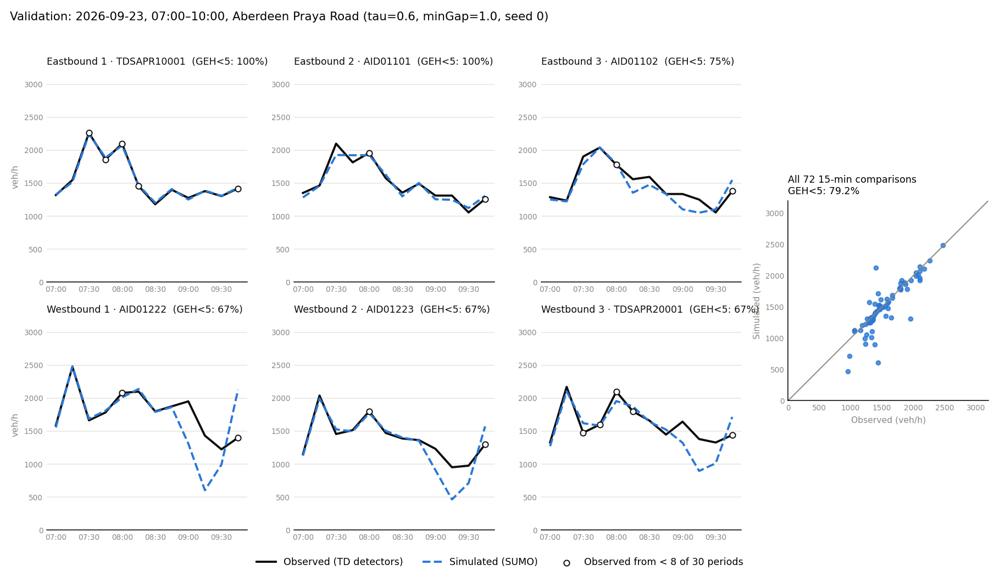

# Aberdeen Praya Road in SUMO

A SUMO model of Aberdeen Praya Road in Aberdeen, Hong Kong: about 1.6 km with 4 signalised
junctions and 5 signalised pedestrian crossings. Demand comes from Transport Department (TD)
detector counts for two weekday mornings, Tue 22 and Wed 23 September 2026.

Short version: on the calibration day the model matches the counts, but only with
car-following parameters pushed to the edge of what's plausible. In a holdout test it predicts
the interior detectors no better than simply scaling the previous day's counts, and the
ranking of signal plans flipped between two versions of the network. So I don't think it can be
used to compare signal plans yet. The sections below show what I did, where it breaks, and what
data I think it needs.


| | |
|---|---|
| Network | OpenStreetMap main roads, converted with netconvert (left-hand traffic), one lane count corrected |
| Detectors | 6 TD detectors, 3 eastbound and 3 westbound, 3 lanes each |
| Data | TD 30-second counts, speeds and lane use from the DATA.GOV.HK archive |
| Period | simulated 06:45-10:15, scored 07:00-10:00 in 15-min bins (6 detectors x 12 bins = 72 comparisons) |
| Fit measure | GEH on hourly rates; target GEH < 5 for at least 85% of comparisons (UK DMRB / TfL, which define it for hourly flows) |
| Vehicles | cars only in the main runs; TD census vehicle mix as a sensitivity run |
| Seeds | 5 per parameter set and per signal plan |

## Calibration (22 Sep)

Demand is fitted to the 22 Sep counts with routeSampler, so the counts will match unless the
model builds queues that don't exist on the real road. I varied three parameters:

- tau: desired minimum time headway in the Krauss model (default 1.0 s)
- minGap: gap to the car in front when stopped (default 2.5 m)
- lcKeepRight: how strongly cars go back to the kerbside lane (default 1)

The detectors show a lot of traffic in the offside lane. In a first grid, lcKeepRight = 0 gave
a lower lane-share error in all 16 (tau, minGap) pairs, so I fixed it at 0.

| tau (s) | minGap (m) | GEH < 5 (mean of 5 seeds) | min-max over seeds | lane-share error (pp) | max teleports | valid |
|---:|---:|---:|---:|---:|---:|---|
| 0.5 | 1.0 | 95.0% | 93.1-95.8% | 19.3 | 19 | yes |
| 0.6 | 1.0 | 94.1% | 87.5-97.2% | 18.7 | 23 | yes, selected |
| 0.8 | 1.0 | 87.8% | 79.2-95.8% | 18.1 | 31 | yes |
| 0.6 | 1.5 | 86.4% | 84.7-88.9% | 18.5 | 36 | yes |
| 0.5 | 1.5 | 85.8% | 77.8-95.8% | 19.1 | 15 | yes |
| 1.0 | 2.5 | 70.3% | 68.1-72.2% | 17.8 | 38 | no (up to 34 vehicles not inserted) |
| SUMO defaults, lcKeepRight 1 | | 70.8% | 66.7-73.6% | 18.9 | 43 | no (up to 58 vehicles not inserted) |

Full table in results/calibration_grid.csv. To pick a set I took the valid ones within 2
points of the best mean (roughly the seed-to-seed spread) and chose the lowest lane-share
error. Lane-share error is the mean absolute difference between simulated and observed lane
shares, at the five detectors where the model has the same number of lanes as the detector.

All runs use a 0.5 s step. A run counts as invalid if it has more than 50 teleports or vehicles
left outside or inside the network at the end. My first grid used SUMO's default 1 s step and
got about 98% for tau = 0.6-0.8 s, but with 7,000-8,300 teleports: when tau is below the step
length the Krauss model isn't collision-free, and teleported cars jump past the bottlenecks. I
threw that grid away (results/calibration_grid_step1s_invalid.csv).


I don't think the selected values say much about Hong Kong drivers:

- minGap 1.0 m is the smallest value I tried, and tau can't go below the 0.5 s step.
- With these values the model discharges queues at 2,298 veh/h/lane (mean headway 1.57 s from
  390 headways on 5 approach lanes at 3 junctions, saturation.py). That's well above the usual
  1,800-2,000 veh/h/lane for cars.
- Lane use is still far off. At AID01102 the kerbside lane has 23% of the real traffic and 61%
  in the model; at TDSAPR10001 the offside lane has 39% real and 3% in the model.

My reading is that the parameters are making up for missing capacity in the network or in the
assumed signal timings.

## Census vehicle mix (sensitivity run)

No counting station on Aberdeen Praya Road is classified by vehicle type, so I used the nearest
one that is: TD Annual Traffic Census 2024, core station 1004 (Aberdeen Tunnel). Weekdays
07:00-10:00: cars, taxis and motorcycles 69.3%, light goods vehicles 15.9%, buses 7.8%, light
buses 4.1%, medium and heavy goods vehicles 2.9%.

With this mix the best grid point only reaches 75.3% (results/calibration_grid_census.csv) and
no parameter set is valid. Westbound traffic queues back from a 4-to-3 lane merge just after
AID01222. In reality the kerbside lane there turns left into a side street, but side streets
aren't in the model, so that lane has to merge back. I tried two fixes, keeping the first
section of every side street and giving turning lanes short exit-only stubs, and both jammed
the corridor. So the main runs use cars only, which is unrealistic for a bus route.

## Second day (23 Sep)

Both tests use the parameters from 22 Sep.

- Transfer: demand rebuilt from all six 23 Sep counts. The counts are partly matched by
  construction, so this is a weak test.
- Holdout: demand is the 22 Sep routes, scaled per direction and 15-min bin by the 23 Sep count
  at the first detector in each direction (TDSAPR10001 eastbound, AID01222 westbound). The four
  interior detectors are never used, so the model is predicting them. As a benchmark I scored a
  naive forecast: the 22 Sep interior count times the same ratio.

| Test | Detectors | Model, GEH < 5 (mean of 5 seeds) | Naive forecast |
|---|---|---:|---:|
| Calibration day | all 6 | 94.1% | |
| Transfer | all 6 | 82.2% (79.2-84.7%), 0 of 5 runs valid | |
| Holdout | 4 interior | 53.3% (mean GEH 4.80), 5 of 5 runs valid | 58.3% (mean GEH 5.47) |



None of the transfer runs passes my validity rule: four have more than 50 teleports (38-79)
and all five still have cars in the network at the end.

In the holdout test the model isn't clearly better than the naive forecast. It passes fewer
comparisons (53.3% vs 58.3%), though its mean GEH is a bit lower (4.80 vs 5.47). For counts at
these detectors, the model doesn't add anything yet.

Speed error is 5.3-5.6 km/h with the fitted parameters and 6.0-6.1 km/h with the defaults. Most
of it is TDSAPR10001, where the model runs at about 64 km/h against 47 km/h observed.

## Signal plans

The 9 signals are 4 junctions and 5 mid-block pedestrian crossings. There are no pedestrians in
the model, so the crossings keep the same fixed timing in every plan and only the 4 junctions
change. Yellow times stay at the network's values and every green is at least 7 s. The Webster
plans use the measured saturation headway (1.57 s). Delay is SUMO's timeLoss plus the time
spent waiting to enter the network (departDelay).

| Plan | Junction timing | 22 Sep delay (s/veh) | vs actuated | 23 Sep delay (s/veh) | vs actuated |
|---|---|---:|---:|---:|---:|
| Fixed-time | netconvert phases, 90 s cycle | 52.8 +/- 7.6 | -33.2 +/- 15.2 | 90.7 +/- 8.7 | -38.2 +/- 18.8 |
| Actuated | same phases, SUMO gap-based actuation | 86.0 +/- 11.1 | | 128.9 +/- 17.1 | |
| Webster | tlsCycleAdaptation, 41-49 s per junction | 143.9 +/- 1.9 | +57.9 +/- 12.0 | 285.9 +/- 4.2 | +157.0 +/- 14.7 |
| Common cycle | Webster splits stretched to 43 s, offsets 0 | 234.7 +/- 3.9 | +148.7 +/- 14.6 | 352.9 +/- 2.3 | +224.0 +/- 17.4 |
| Coordinated | common cycle with tlsCoordinator offsets | 234.0 +/- 2.4 | +148.0 +/- 12.2 | 352.0 +/- 1.8 | +223.1 +/- 17.2 |

+/- is the 95% CI over 5 seeds; "vs actuated" is the paired difference (same seed, same
demand). Junction timings and degrees of saturation are in results/signal_design.csv.


In this version the fixed 90 s plan has the least delay. In the version before (without the
lane fix at TDSAPR10001 and the change to trip ends, so with different fitted parameters),
actuated came out best. Both versions fit the counts, so the counts can't tell me which ranking
to believe.

The short-cycle plans (41-49 s) lose most of their time at the network entries. Queues reach the
boundary and cars wait to get in: for the common cycle on 22 Sep, 158.8 of the 234.7 s is
waiting to enter, and on average 449 of 16,403 cars never got in before the end, so its delay is actually
understated. Webster's formula says these junctions are lightly loaded (degree of saturation
0.21-0.63), so the queues must come from short links and spillback, which the formula doesn't
see.

Offsets make no difference compared with the same common cycle and zero offsets.

## So what is it good for?

It shows the whole workflow: importing the network, matching detectors, building demand from
counts, calibrating over several seeds, holdout testing and comparing plans on equal terms. It
also shows where a model of this corridor stops being believable.

It can't tell you which signal plan is better yet. The fitted parameters give an unrealistic
saturation flow, the model doesn't run cleanly on the second day, it doesn't beat naive scaling
on held-out detectors, it can't carry the real vehicle mix, and the plan ranking changes with
network details.

## Known issues

- Lane use doesn't match the detectors (lane-share error about 18-19 pp).
- The westbound merge after AID01222 can't carry the real flow once buses and goods vehicles are in.
- TD doesn't publish signal timings, so every plan starts from netconvert's generated phases.
- Only 128 (22 Sep) and 140 (23 Sep) of the 360 thirty-second periods between 07:00 and 10:00
  could be downloaded. A 15-min bin has between 3 and 18 of its 30 periods, and each count is
  scaled up to 30. Bins with fewer than 8 periods are marked with open circles in the plots.
- Side-road counts taken as the difference between two neighbouring detectors ignore the travel
  time between them and carry the sampling error of both.
- At TDSAPR10001 the model is about 17 km/h too fast (64 vs 47 km/h).
- Only two days of data.

## Next steps

1. Check lane counts, lane connections and the merge after AID01222 on aerial imagery or on site,
   and add the side street there so left-turning traffic can leave.
2. Ask TD for the junction timings. With real timings the signals stop being a guess and only
   driver behaviour needs calibrating.
3. Use the census vehicle mix once the network can carry it, and calibrate on speeds and lane
   shares as well as counts.
4. Repeat the holdout test on more days.

## Earlier versions

- First version (9 Oct): reported that a coordinated plan cut delay by 20-47%. I withdrew this.
  The redesigned plans had shorter yellows than the baseline, the pedestrian crossings had
  different timings in different plans, and time spent waiting to enter wasn't counted.
- Second version (11 Oct): fixed those three things, added the common-cycle run and 5-seed
  calibration. Actuated came out best.
- This version (12 Oct): lane fix at TDSAPR10001, no trips starting or ending on detector edges,
  lane-change parameter, wider grid, census mix, measured saturation flow, holdout test. The
  11 Oct ranking didn't survive.

## Method

| Step | Script | |
|---|---|---|
| 1 | build_network.py | downloads OSM, corrects one lane count, builds the left-hand network with main roads only, joins 10 dead-end lanes to the road ahead |
| 2 | download_data.py | downloads the TD archive for the chosen days and keeps the 6 detectors |
| 3 | detectors.py | matches each detector to a network edge, lane count first, then distance |
| 4 | counts.py, demand.py | 15-min counts, then routes that reproduce them with routeSampler |
| 5 | calibrate.py, plot_calibration.py | grid search on 22 Sep (calibrate.py census for the census mix) |
| 6 | saturation.py | queue-discharge headways at the junctions |
| 7 | validate.py | transfer and holdout tests on 23 Sep |
| 8 | compare_signals.py, plot_signals.py | signal plan comparison |
| | plot_network.py | the map at the top |

Lane fix: OSM way 245466671 (eastbound, where TDSAPR10001 is) says 2 lanes, but its own
turn:lanes tag lists three and the detector reports three, so I convert it with 3 lanes. After
the fix the detector sits 5.6 m from its published position instead of 32 m.

Demand: side streets aren't modelled. Trips can start and end at the network boundary and on
Aberdeen Praya Road edges longer than 20 m without a detector, which stand in for car parks,
buildings and kerbside stops. Candidate routes are the fastest paths between 37 entries and 34
exits (642 pairs with a path), weighted by road class and lane count at boundary ends and by
the narrowest lane count on the route. Where exactly one side road lies between two
neighbouring detectors, its count is the difference of the two detector counts (same bin,
negatives set to 0).

## How to run

From this folder, with SUMO 1.18 and SUMO_HOME set (pip install -r ../requirements.txt). The
network, detector data and route files are in the repo, so the optional steps can be skipped.
Times are on 4 cores.

```bash
python build_network.py                    # optional, rebuilds network/aberdeen.net.xml
python download_data.py 20260922 20260923  # optional, the archive may no longer be complete
python demand.py 20260922 20260923         # optional, route files are deterministic (seed 42)
python calibrate.py                        # 80 runs, about 1 h 45 min
python plot_calibration.py calibration 20260922
python saturation.py                       # one TraCI run, a few minutes
python validate.py 20260923                # 25 runs, about 35 min
python plot_calibration.py validation 20260923
python compare_signals.py                  # 50 runs, about 55 min
python plot_signals.py
python plot_network.py
python calibrate.py census                 # optional sensitivity run, 80 runs, about 2 h
```

## Data

- Road network: (c) OpenStreetMap contributors, ODbL (https://www.openstreetmap.org/copyright).
  Raw extract in network/aberdeen_bbox.osm.xml, downloaded 9 Oct 2026.
- Detector counts, speeds and locations: Transport Department, HKSAR Government, via
  DATA.GOV.HK (https://data.gov.hk), under the DATA.GOV.HK terms and conditions. Counts are from
  the historical archive of rawSpeedVol-all.xml; data/detector_locations.csv is TD's detector
  location dataset.
- Vehicle mix: TD Annual Traffic Census 2024, core station 1004 report (atc.td.gov.hk), table
  "Vehicle classification and occupancy - Monday to Friday".
