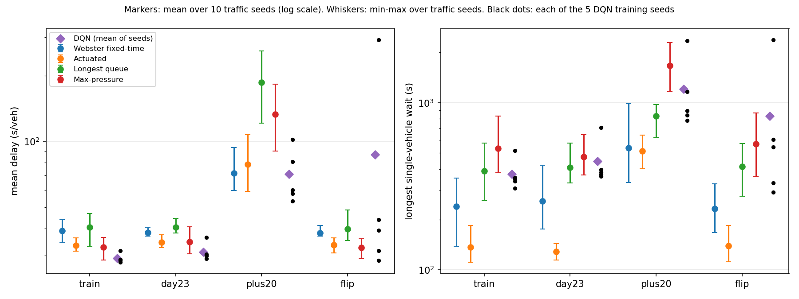
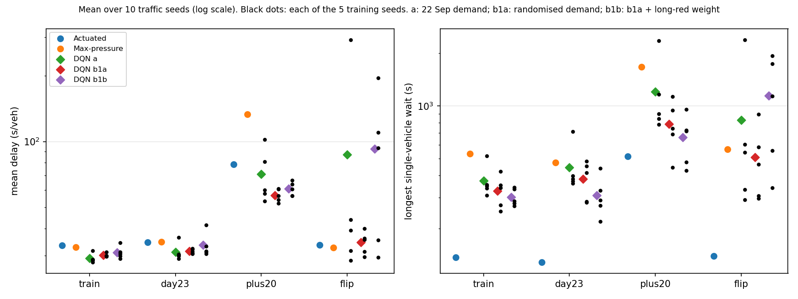
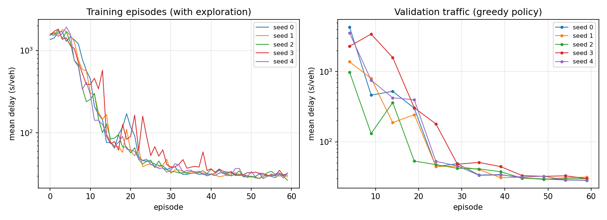

# A DQN signal controller at one junction, against four baselines

The corridor model in `hk_corridor/` cannot yet rank signal plans (see its README), so learned
control is tested here on a junction whose layout and signal rules are fully specified: one
4-arm junction in SUMO, left-hand traffic, with the time profile of the Aberdeen Praya Road
detector counts. A Double DQN
written in PyTorch is compared with Webster fixed-time, SUMO's actuated control,
longest-queue-first and max-pressure, on traffic it was trained on and on three kinds it never saw.



## Main results

Mean delay in s/veh (timeLoss + departDelay), mean of 10 traffic seeds that were never used in
training. DQN: 5 independently trained networks; the column shows the mean and, in brackets, the
range over the 5. Paired difference: same traffic seed, DQN averaged over its 5 networks, 95% CI
over the 10 seeds.

| Test traffic | Webster | Actuated | Longest queue | Max-pressure | DQN | DQN minus actuated |
|---|---:|---:|---:|---:|---:|---:|
| train: training demand, new seeds | 39.0 | 33.4 | 40.4 | 32.8 | 29.1 (28.0-31.6) | -4.3 +/- 0.9 |
| day23: 23 Sep profile | 38.3 | 34.5 | 40.6 | 34.8 | 31.2 (29.1-36.3) | -3.3 +/- 1.3 |
| plus20: every flow +20% | 71.6 | 78.6 | 186.7 | 133.5 | 70.8 (53.3-102.3) | -7.8 +/- 10.0 |
| flip: W/E and N/S swapped | 38.2 | 33.6 | 39.8 | 32.6 | 87.2 (28.5-292.8) | +53.6 +/- 40.5 |

Longest single-vehicle wait (s), same runs:

| Test traffic | Webster | Actuated | Longest queue | Max-pressure | DQN |
|---|---:|---:|---:|---:|---:|
| train | 239 | 137 | 391 | 533 | 374 |
| day23 | 257 | 129 | 410 | 475 | 446 |
| plus20 | 537 | 515 | 831 | 1,668 | 1,206 |
| flip | 233 | 139 | 414 | 566 | 830 |

What this shows:

1. On traffic like the training traffic, including another day's profile, the DQN has the lowest
   mean delay: 3.3-4.3 s/veh less than actuated control and 3.5-3.6 s/veh less than max-pressure,
   and the 95% CIs exclude zero.
   Four of the five networks land within 2 s of each other; seed 3 is weaker.
2. It does this partly at the expense of a few drivers. The reward is total waiting, with no
   fairness term, and its longest single wait is about 3 times that of actuated control.
3. It does not transfer reliably. With the directions swapped, two networks stay at 28-32 s/veh,
   two have occasional bad runs (up to 135 s/veh), and seed 3 fails: 5 of its 10 runs leave
   vehicles unserved, with the southern approach at 805 s/veh. In training that approach had
   the lightest demand, so the network probably learned to neglect it rather than to respond to
   its queue.
   The validation runs used for checkpoint selection (training demand only) did not show this:
   seed 3's chosen checkpoint scored 29.9 s/veh there.
4. At +20% demand, where the peak exceeds capacity, every method degrades. Longest-queue and
   max-pressure degrade most. The DQN mean is close to Webster's, with a wide spread over seeds;
   the difference from actuated control is not significant.
5. Actuated control is never the best on mean delay but is the most even: the lowest longest wait
   in every scenario and no invalid runs.

All baseline runs are valid. DQN runs are valid 50/50 (train, day23), 46/50 (plus20), 45/50 (flip).

## Follow-up: training on varied demand (b1a) and a long-red weight (b1b)

Two changes, tested one at a time on the same 4 scenarios and 10 traffic seeds, 5 networks each:

- b1a: each training episode scales every approach by its own random factor in 0.6-1.4 and the
  whole junction by one in 0.85-1.1; validation adds 2 seeds of such demand to the 2 of 22 Sep.
- b1b: b1a, plus a reward term that counts halted vehicles twice on any phase red for 90 s or more.



Mean delay (s/veh), mean of the 5 networks, range in brackets, and valid runs out of 50:

| Test traffic | a | b1a | b1b | Actuated |
|---|---:|---:|---:|---:|
| train | 29.1 (28.0-31.6), 50 | 30.2 (29.8-31.2), 50 | 31.0 (29.1-34.4), 50 | 33.4 |
| day23 | 31.2 (29.1-36.3), 50 | 31.5 (30.6-32.4), 50 | 33.6 (30.6-41.5), 50 | 34.5 |
| plus20 | 70.8 (53.3-102.3), 46 | 56.8 (52.1-60.9), 50 | 60.7 (56.3-66.4), 50 | 78.6 |
| flip | 87.2 (28.5-292.8), 45 | 34.5 (29.6-40.0), 50 | 92.7 (29.4-195.1), 47 | 33.6 |

Longest single-vehicle wait (s), mean of the 5 networks:

| Test traffic | a | b1a | b1b | Actuated |
|---|---:|---:|---:|---:|
| train | 374 | 328 | 302 | 137 |
| day23 | 446 | 383 | 310 | 129 |
| plus20 | 1,206 | 789 | 661 | 515 |
| flip | 830 | 508 | 1,139 | 139 |

1. Varied training demand removed the failures. Under b1a all 200 runs are valid, and with the
   directions swapped the 5 networks stay within 29.6-40.0 s/veh, level with actuated control
   (+0.9 +/- 2.0 s/veh). This test is no longer unseen for b1a, since its training demand
   includes approaches busier than in 22 Sep. day23 is still another day's profile, and plus20
   raises the whole junction beyond the training range.
2. Under +20% demand b1a has 21.8 +/- 6.4 s/veh less delay than actuated control, the lowest of
   all methods. Its training never raised the whole junction above 1.1 times the base load,
   though single approaches went up to 1.54 times.
3. The cost on training-like traffic is about 1 s/veh (29.1 to 30.2); b1a is still 3.3 +/- 0.7
   s/veh below actuated control there.
4. The long-red weight did not work as intended. It lowered the longest wait on train and day23
   traffic, but with directions swapped three of the five b1b networks again neglect the southern
   approach (216-727 s/veh there). One possible reason, not checked: a 10 s minimum green resets
   the red timer without clearing the queue, so the weight can be met with short greens.
5. Every DQN variant still makes some vehicles wait much longer than actuated control does:
   1.5-3.7 times as long for b1a, up to 8 times for b1b with directions swapped.

## Setup

| | |
|---|---|
| Junction | 4 arms of 300 m, 3 lanes in (kerbside left + straight, straight, right only) and 3 out, 50 km/h |
| Phases | N-S straight + left, N-S right, E-W straight + left, E-W right (right turns protected) |
| Saturation flow | measured in SUMO (`saturation.py`): 1,658 veh/h/lane straight/left, 1,739 right |
| Demand | 15-min profile 06:45-10:00 from TDSAPR10001 (eastbound) and AID01222 (westbound); side road at 45% (N) and 30% (S) of the mean main-road flow; turns 15/70/15%; Poisson arrivals |
| Load | scaled so Webster's Y = 0.70 in the training day's peak hour (0.87 in the busiest 15 min) |
| Webster plan | 100 s cycle, greens 19/10/44/15 s, 4 s lost time per phase |
| Actuated | SUMO gap-based actuation on the same phases, min 10 s, max 60 s |
| Rules for every TraCI controller | decision every 5 s, min green 10 s, max green 60 s, 3 s yellow, a phase red for 180 s with vehicles on its lanes is served next |
| DQN | 2 x 128 MLP; input: halted and total vehicles per lane, current phase, time in green, time each phase has been red; action: next green phase; reward: minus vehicle-seconds of waiting (including vehicles that cannot enter); Double DQN, Huber loss, gamma 0.95 per decision, Adam 5e-4 |
| Training | 60 one-morning episodes per network, epsilon 1.0 to 0.05 over the first 24, a new traffic seed each episode; 5 networks (seeds 0-4) |
| Checkpoint | the one with the lowest delay on 2 validation seeds, among checkpoints whose validation runs were all valid |

Traffic seeds are kept apart: training uses 1000 and above, validation 200-201, evaluation
100-109 (a test checks this).

Scoring counts vehicles that had not finished when a run ended (delay so far, or time since
their planned departure if they never entered) and marks the run invalid. An earlier version
dropped them; an untrained network that starved two approaches then looked better than
max-pressure.



## Limitations

- One synthetic junction. The time profile is real; the side-road shares and turning shares
  are assumed, and the junction is not Aberdeen Praya Road.
- Isolated junction with free-flowing exits, so max-pressure has little downstream information
  to use and behaves much like longest-queue.
- No hyperparameter tuning; the values were fixed before the runs. In variant a three of five
  networks were still improving on validation at episode 60.
- In variant a, validation used only the training demand and selected checkpoints that failed on
  swapped directions; b1a addresses this, but its tests are partly inside its training range.
- The reward has no working fairness term (b1b did not achieve one), and single waits stay well
  above actuated control.
- Cars only, no pedestrians, SUMO default driver model.

## How to run

From this folder, SUMO 1.18 with SUMO_HOME set, `pip install -r ../requirements.txt` and
PyTorch (`pip install torch==2.3.1 --index-url https://download.pytorch.org/whl/cpu`).
Times are on a 4-core laptop CPU. `QUICK=1` runs a short version of every step.

```bash
python build_net.py      # network/
python saturation.py     # prints the measured saturation flow (about 1 min)
python demand.py         # prints the load per 15 min and scenario
python webster.py        # writes network/webster.tll.xml
python dqn.py            # 5 networks x 60 episodes, about 4 h with WORKERS=5
python evaluate.py       # 360 runs, about 3.5 h on 4 cores
VARIANT=b1a python dqn.py && VARIANT=b1a python evaluate.py   # DQN runs only, baselines reused
VARIANT=b1b python dqn.py && VARIANT=b1b python evaluate.py
python plot.py           # results/variants.png once all three are done
```

Training b1a and b1b at the same time (10 processes on 4 cores) took about 10 h, and each of
their evaluations about 2 h.

Tests: `python -m pytest tests/rl_signal` from the repository root (the SUMO tests are skipped
if the `sumo` binary is not on the path).

| File | |
|---|---|
| `build_net.py` | network and the 4 green phases |
| `saturation.py` | measured saturation flow |
| `demand.py` | demand profile, scaling, scenarios, route files |
| `webster.py` | fixed-time plan |
| `env.py` | the environment: signal rules, observation, reward, scoring |
| `controllers.py` | longest-queue and max-pressure |
| `dqn.py` | network, replay buffer, training loop, checkpoint selection |
| `evaluate.py` | all methods on all scenarios; writes `results/` and the SQLite tables `rl_eval_runs`, `rl_training` |
| `plot.py` | figures |

Trained networks are in `models/`, `models_b1a/` and `models_b1b/`, results in `results/`,
`results_b1a/` and `results_b1b/`. Code written with the help of an AI coding assistant; the
experiment design and conclusions are my own.
